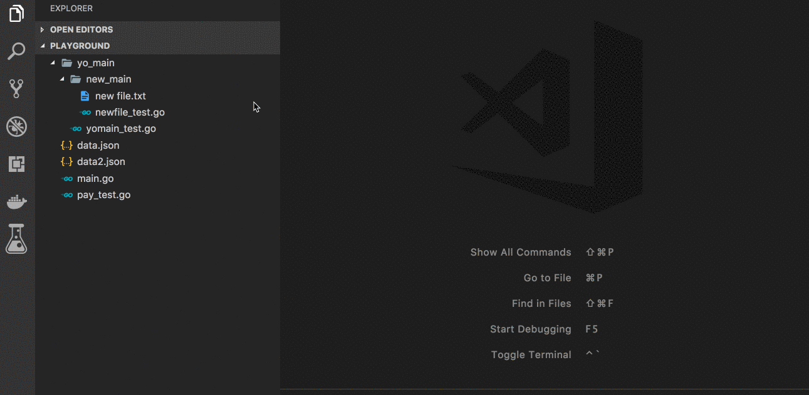

# Go Test Explorer

Run and explore Go tests in a tree view inside Visual Studio Code.



## Features
- Discover `*_test.go` files and functions without spawning external tools
- Run tests per file, per suite, or all tests in a module in one `go test` invocation
- Parse `go test -json` for accurate results and subtest failures
- Cancel running tests (kills the process tree)
- Show test output in a terminal (with colors) or an output channel
- Respects `go.*` settings as fallback; configurable via `goTestExplorer.*`

## Requirements
- Go installed on `PATH` (or configured via `goTestExplorer.goBinary`/`goTestExplorer.goPath`)
- The [Go extension](https://marketplace.visualstudio.com/items?itemName=golang.go) is optional

## Configuration
See the extension settings for `goTestExplorer.*`: `maxParallelTests`, `skipFolders`, `goPath`, `goBinary`, `testFlags`, `buildTags`, `timeout`, `envFile`, `env`, `runInTerminal`.

## Development
```bash
npm install
npm run compile
npm run lint
npm run test
npm run package
```

## License

[MIT](LICENSE)
